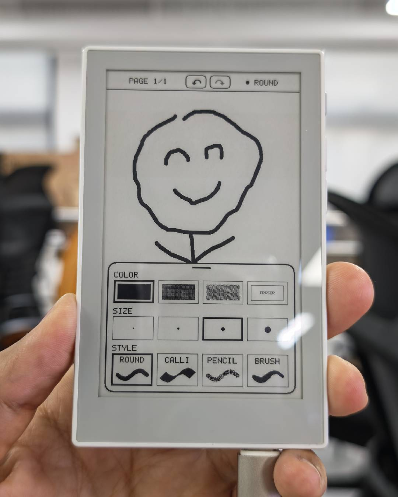

# Sticky Handwriting Pad

An offline community handwriting notebook by [limengdu](https://github.com/limengdu) for Seeed Studio reTerminal Sticky.

- [Project and build instructions](https://github.com/limengdu/reterminal_sticky_handwriting_pad)
- [Hardware-tested 0.1.0 firmware](https://github.com/limengdu/reterminal_sticky_handwriting_pad/releases/tag/v0.1.0)
- [Support](https://github.com/limengdu/reterminal_sticky_handwriting_pad/issues)
- [MIT license](https://github.com/limengdu/reterminal_sticky_handwriting_pad/blob/d30955bd6a497dd6d14d660e1d634f3ef97c5112/LICENSE)



## Latest Registry package: 0.1.1

- Automatically detect SSD1677 and SSD2677 and select the matching display driver.
- Read panel identification through bidirectional GPIO14 at 2 MHz.
- Add SSD2677 monochrome, partial, four-gray, temperature-waveform, and sleep support while preserving the existing notebook storage layout.
- Align the Registry version, runtime version, and ESP-IDF application descriptor at `0.1.1`.
- Add a host regression check that rejects inconsistent version declarations.

### Package provenance

- Source: [c01e2d600dd691d9dd221fd15236c5e98e9f4731](https://github.com/limengdu/reterminal_sticky_handwriting_pad/commit/c01e2d600dd691d9dd221fd15236c5e98e9f4731).
- Registry / runtime / ESP-IDF descriptor version: `0.1.1`.
- Build profile: `sticky-release`, PlatformIO `espressif32@6.11.0`, ESP-IDF `5.4.1`.
- Target: ESP32-S3, 32 MB flash, DIO, 80 MHz; USB serial flashing at 460800 baud.
- Origin: a new local release build after aligning version declarations. The files were copied byte-for-byte from that build, not from a CI artifact or a device flash dump.
- License: MIT.
- Historical versions already present on Registry `main` remain unchanged. The earlier candidate package is retained in this PR's commit history and linked below.

| File | Offset | Bytes | SHA-256 |
| --- | --- | --- | --- |
| `bootloader.bin` | `0x0` | 22464 | `70eae3502cb3fc0d82e518329ad1c877816a506728c6b7e7b140eb5e4cd9826f` |
| `partitions.bin` | `0x8000` | 3072 | `87c890a6a25424bf3c16606f8dfc63edfa88a535f562cc4a87b0768e704244c9` |
| `firmware.bin` | `0x10000` | 392528 | `cd4059b3b4635695cf30af40944711cbb203ed71d05cfe51443e3a7dfb1db5db` |

### Automated verification

Host panel/SPI regression tests, version consistency checks, ASan/UBSan, and release/debug builds passed. This project has no GitHub Actions workflow.

The consistency checker was also verified to reject a deliberately mismatched runtime/descriptor pair. Image inspection confirms version `0.1.1`, ESP32-S3, 32 MB flash, and valid checksums and validation hashes. All package sizes and SHA-256 values match the new build outputs; the partition table is unchanged.

### Hardware acceptance of this rebuild

**Pending: these newly rebuilt binaries have not been installed or re-tested on a physical device.** No device was flashed or reset while preparing this version-alignment update. The prior observations below apply only to the older source/hash, not these new bytes.

Before acceptance, install the new manifest package and check boot/version, the main workflow, touch/buttons, reboot and saved state, sleep/wake, USB reconnection, and repeated installation on the relevant SSD1677 and SSD2677 devices.

### Prior hardware evidence (2026-11-11)

- Previously tested source: [b50abf3f0e5d553131026ef53a1f4810c1a2b9fa](https://github.com/limengdu/reterminal_sticky_handwriting_pad/commit/b50abf3f0e5d553131026ef53a1f4810c1a2b9fa).
- Previously tested application SHA-256: `f1622b8bdbf2477e283b80c6d01ff5be79ccc6e38578e8c091aa20f2056b253c`.
- [Exact earlier candidate package preserved in commit history](https://github.com/limengdu/reterminal-sticky-playground-registry/tree/e492438451d6033778c02a87caf3d040c2c29167/firmwares/sticky-handwriting-pad/firmware/0.1.1).

| Check | Prior evidence / scope |
| --- | --- |
| SSD1677 and SSD2677, previous tested release | Black and gray handwriting and display refresh passed; maintainer confirmed both revisions |

These records do not certify the version-aligned rebuild above. Historical package records further below also retain their original version-specific scope.

### Upgrade notes

Select `0.1.1` for this update. Save the notebook with the AI button and wait for sleep before upgrading. Keep the existing flash contents when updating the same project if you need its saved data; a full erase deletes that data. When switching from a different project, use a clean installation as described below. No partition layout is changed by this update.

## Features

- Finger-operated writing and sketching, with up to 20 notebook pages.
- Round, calligraphy, pencil, and speed-sensitive brush styles.
- Four pen sizes; black, dark gray, light gray, and white eraser.
- Per-page undo and redo, up to 50 steps per page within the shared memory budget.
- Floating touch toolbar and physical buttons for page navigation.
- Notebook pages, pen settings, and undo history saved before sleep and restored on wake or a saved power cycle.
- Automatic save and deep sleep after one minute of inactivity.
- Local operation with no network account or external storage required.

## Controls

Use portrait orientation with the hardware buttons on the right.

| Control | Action |
| --- | --- |
| Touch the page | Write or erase |
| Page Up | Previous page |
| Page Down | Next page; create a new one at the end, up to 20 |
| AI button, short press | Save and sleep; press again to wake |
| AI button, hold for one second | Open the clear-page confirmation |
| Undo / redo in the top bar | Undo or redo an edit on this page |
| Tap the bottom handle or swipe up from the bottom | Open the pen toolbar |
| Swipe down, tap the toolbar grip, or tap outside | Close the toolbar |

Start writing above the bottom 48-pixel gesture area. Before disconnecting power, press the AI button and let the device finish saving and enter sleep, indicated by the moon icon.

## Historical 0.1.0 firmware package

- Version: `0.1.0`, experimental.
- Source: [https://github.com/limengdu/reterminal_sticky_handwriting_pad](https://github.com/limengdu/reterminal_sticky_handwriting_pad), commit `d30955bd6a497dd6d14d660e1d634f3ef97c5112`.
- License: MIT, copyright 2026 limengdu.
- Artifact origin: original PlatformIO `sticky-release` binaries from the upstream project's hardware-tested local build, also published in its `v0.1.0` release.
- Build configuration: `espressif32@6.11.0`, ESP-IDF 5.4.1, ESP32-S3R8, 32 MB flash.
- Flash settings: DIO, 80 MHz, 460800 baud.
- Delivery: a firmware-only package with its maintained upstream source linked above.

The manifest records the flash layout, byte size, and SHA-256 of every file:

| File | Offset | Bytes | SHA-256 |
| --- | --- | --- | --- |
| `bootloader.bin` | `0x0` | 22464 | `b5176b7b1a0ace49e2dde1f21f7e51565cca2a650b21a7cbf2e223b02bef1e18` |
| `partitions.bin` | `0x8000` | 3072 | `87c890a6a25424bf3c16606f8dfc63edfa88a535f562cc4a87b0768e704244c9` |
| `firmware.bin` | `0x10000` | 378320 | `20e0eca585463b8086d4efade67c3b7ef2cbe3c003e9ee525b5db320b1515f58` |

The notebook uses the `notes` partition (2 MB) for pages and settings and the `history` partition (4 MB) for undo/redo records.

## Installation

Open the Sticky Playground firmware page, connect the device with a USB data cable, and install the latest package `0.1.1` using desktop Chrome or Edge. The supplied manifest includes all three files needed for a fresh installation.

For a local source build and upload:

```sh
pio run -e sticky-release
pio run -e sticky-release -t upload
pio device monitor -b 115200
```

Run these commands from the upstream project root.

## Historical 0.1.0 hardware test record

| Item | Record |
| --- | --- |
| Device | Physical reTerminal Sticky |
| Firmware | Original `sticky-release` application, version `0.1.0` |
| Test date | 2026-10-16 |
| Device testing | The project maintainer confirmed this build was tested on-device |
| Preview | Maintainer-provided photo of handwriting and the pen toolbar on the device |
| Source build | A clean copy of the published source compiled successfully with the pinned PlatformIO platform |
| Package integrity | Packaged binaries retain the original build's SHA-256 values |

## Device verification steps

1. Install the package and check the notebook opens.
2. Write continuous strokes; try every pen style, size, and color.
3. Exercise undo, redo, clear confirmation, and clear cancellation.
4. Create and switch pages using the side buttons.
5. Save with the AI button, wake, and check pages, pen settings, and undo history. Repeat with a power cycle after saving.
6. Leave the notebook idle for one minute and check automatic sleep.
